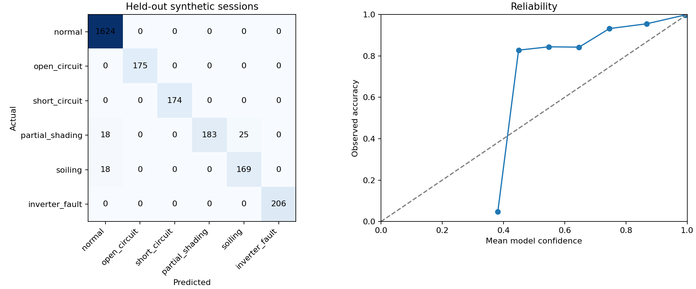

# SolarSense

SolarSense monitors three solar stations using a simulator or the original ESP-NOW gateway, detects supported fault patterns, records incidents, and shows what the model used to make a prediction. I built it to practise the full path from sensor-like data to ML inference, a working dashboard, and repeatable tests without buying hardware first.

**The included dataset and reported benchmark are synthetic.** Hardware mode accepts real measurements through the original ESP-NOW gateway or a serial bridge and uses the original five-class hardware model. The dashboard labels the source. Physical relay commands require explicit server enablement and gateway feedback.

## Run it

Use Python 3.12 and run these commands from the repository root. A GPU, Node.js, Docker and paid APIs are not required for this path.

```bash
python3.12 -m venv .venv
source .venv/bin/activate
python -m pip install -r requirements.txt
python -m pip install --no-deps -e .
python -m solarsense setup
python -m pytest -q
python -m solarsense demo
```

On Windows, use `py -3.12 -m venv .venv` and `.venv\Scripts\Activate.ps1` instead of the first two commands. The remaining commands are the same. If PowerShell blocks activation, call `.venv\Scripts\python.exe` directly. Do not change the machine-wide execution policy.

Open http://127.0.0.1:8000. Paste the operator key printed in the terminal and click Connect. `python -m solarsense credentials` also shows the local keys. Use the viewer key in another browser window to demonstrate read-only access. Ctrl+C stops the server and simulator launched by `demo`. Start/Stop Monitoring on the page only starts or stops that browser subscription; it does not stop the independent simulator. The default interview scenario finishes after about eight minutes, after which stations show stale values. A fresh online simulator run advances each station to a new event day when needed so old readings do not hide the new session; the selected start is recorded in the run spool. Resuming a run keeps its existing timeline. Event time is simulated and may differ from wall time.

The first setup generates synthetic data, trains the simulation models and promotes a checked release. The original hardware model is included separately. Later calls reuse it. Installation downloads packages; the configured demo then runs offline. The interview scenario runs for eight minutes. Run `demo` again for another session, or use the separate-process commands in [DEMO.md](docs/DEMO.md).

For a compressed day and a quickly available forecast:

```bash
python -m solarsense demo --scenario scenarios/day.yaml
```

The compressed day advances event time by five minutes every 0.2 seconds. Heartbeats still use wall time. The normal demo advances event time by two seconds every two seconds; its forecast needs about 15 minutes of continuous history, so the default eight-minute interview run shows an explicit forecast warmup message.


### Original dashboard source

The source is in `frontend/`. The included export in `src/solarsense/static/` opens at the same http://127.0.0.1:8000 address. No frontend install is needed to run the project. If changing the React components, use Node.js 24 and run these commands from the repository root:

```bash
npm ci --prefix frontend
npm run typecheck --prefix frontend
npm run build --prefix frontend
```

The build copies the export into the Python package. Restart the backend and hard-refresh the browser after updating it. Scripts are external files; inline styles are allowed for Recharts and Framer Motion, while inline JavaScript stays blocked by CSP.

Preset controls change simulated conditions. Manual controls pass voltage, current, temperatures, humidity, ADC light, irradiance and AC power through the independent simulator and the same inference path. Fixed manual values can trigger stuck-sensor detection. Manual samples have no asserted ground-truth fault label. CSV downloads contain the selected station's latest 500 stored readings, including missing values and source labels. Hardware and simulator modes are selected per station. Current weather comes from Open-Meteo when online. Technician contacts can receive automatic SMS or WhatsApp alerts through Twilio; preview mode works without an account. See [HARDWARE.md](docs/HARDWARE.md) and [TECHNICIAN_ALERTS.md](docs/TECHNICIAN_ALERTS.md). The original ungrounded efficiency percentage is replaced by irradiance because the simulation does not provide a measured panel area for physical conversion efficiency.

The previous operations dashboard remains at `/operations/`. Both pages use the same backend; each requires its own in-memory access key.

## What works

The simulator runs independently of the dashboard. Telemetry is validated, authenticated, deduplicated and committed before acknowledgement. A single worker produces predictions, temporal decisions, incidents and notification jobs. Missing readings become a data-quality result. Late arrivals stay in history without replacing newer live values. A backend restart recovers accepted, unfinished work.

The ML code compares rules, a Random Forest and gradient boosting using whole-session splits. It also evaluates sigmoid probability calibration, Isolation Forest novelty scores, TreeSHAP explanations, healthy expected AC output, and 15/30/60-minute forecasts. Validation selects the probability method and forecast policy. A three-of-five vote rule stabilizes decisions. Operators can acknowledge incidents, submit independent reviews, inject simulation faults and request explicit virtual relay states.

The dashboard keeps the original dark theme, circular sensor gauges, expandable history charts, station selector and freeze controls. It also shows actual versus expected power, forecasts, explanations, incidents, notification attempts, model results and label review. Station 1 is East roof, Station 2 is West roof, and Station 3 is Lab panel. A frozen display affects only that viewer. The default notification destination is a durable in-app inbox. Per-station technician alerts are also recorded in preview mode; actual SMS/WhatsApp requires explicit live configuration.

## Measured results

These numbers were produced during implementation, not estimated. The dataset has 12,096 rows across 84 sessions. The test partition contains 2,592 rows from 18 held-out sessions. Fault timing, sensor gains, panel parameters, cloud levels and severity vary between sessions. The generator and split manifest use seed 42.

| Measurement | Held-out synthetic result |
| --- | ---: |
| Selected classifier accuracy | 97.65% |
| Selected classifier macro F1 | 0.9618 |
| Accepted prediction coverage | 96.95% |
| Accuracy among accepted predictions | 98.77% |
| Healthy expected-power MAE | 6.31 W |

| Classifier | Validation macro F1 | Test macro F1 |
| --- | ---: | ---: |
| rules | 0.9294 | 0.8339 |
| random forest | 0.9357 | 0.9618 |
| boosting | 0.9201 | 0.9439 |

The Random Forest provides direct tree explanations and is the served classifier. Sigmoid calibration was tried on a separate calibration split. Its validation log loss was 0.4464, compared with 0.1107 for the original forest. The app therefore serves **uncalibrated forest probabilities**, with that method shown in the interface. Calibration is an evaluated experiment, not an improvement claimed without evidence.

Confusion matrix: rows are actual labels and columns are predictions, in this order: normal, open circuit, short circuit, partial shading, soiling, inverter fault. This includes every test prediction before abstention.

```text
 1624     0     0     0     0     0
    0   175     0     0     0     0
    0     0   174     0     0     0
   18     0     0   183    25     0
   18     0     0     0   169     0
    0     0     0     0     0   206
```

| Forecast horizon | Forest MAE | Persistence MAE | Selected on validation |
| --- | ---: | ---: | --- |
| 15 min | 11.91 W | 13.28 W | forest |
| 30 min | 19.22 W | 24.55 W | forest |
| 60 min | 30.14 W | 43.23 W | forest |

The incident replay contains 15 fault events, 1 missed event(s), and 3 incorrect alert transition(s). Median detection delay is 600 **event seconds** at a five-minute sampling interval. This is not live API latency. Complete class metrics, reliability data, session bootstrap intervals, stress results and system timings are in [reports/](reports/) and explained in [MODEL_CARD.md](docs/MODEL_CARD.md).



## Reproduce the numbers

From a clean clone, `setup` creates the measured-size dataset and trains the default model. Then run:

```bash
python -m solarsense evaluate
python -m pytest -q --junitxml=reports/pytest.xml
```

For a new experiment, use `python -m solarsense generate` followed by `python -m solarsense train --trees 80`. Training saves an immutable release. Repeating the exact same source/data/settings in the same model directory returns an explicit existing-release error; reuse that release, choose a new experiment, or use a fresh checkout. Training does not replace the serving model. Promotion and rollback commands are in [OPERATIONS.md](docs/OPERATIONS.md).

**My local rerun record — fill this after running on my machine:** not recorded yet. Copy accuracy, macro F1 and the confusion matrix from `reports/metrics.json`, and record the date, Python version and test output here. The measured results above remain the implementation reference.

## Tests and deployment

`python -m pytest -q` runs the regression suite, including real process termination and restart. Runtime depends on the machine; the mounted D: drive can make process startup substantially slower. The integration update has 43 passing tests. It checks leakage, identity collisions, concurrent retries, authorization, WebSockets, late readings, offline state, commands, notifications, model integrity, backup restoration and simulator buffering.

For Docker with PostgreSQL, first run `python deploy/init_compose.py`, then `docker compose up --build`. Open http://127.0.0.1:8080. This route uses separate API, simulator, frontend and database services. Prometheus/Grafana and MLflow are optional profiles. Docker was not available in the implementation environment, so its runtime and image scans must pass in GitHub Actions or on a Docker host before calling that deployment verified.

[ACCEPTANCE.md](docs/ACCEPTANCE.md) maps the original plan to evidence and remaining checks. [GIT.md](docs/GIT.md) contains the seven-commit progression and exact GitHub push commands. [OPERATIONS.md](docs/OPERATIONS.md) covers backup, restore, configuration and model changes.

## Limitations

The original hardware was tested by the project owner. This update was verified with gateway fixtures and original-model equivalence checks; I did not rerun physical hardware here or measure independent field-labelled accuracy. The synthetic rules simplify PV behaviour, and train/test data share the same generator family. Shading and soiling overlap; mild losses and unfamiliar conditions can be missed or confidently assigned to a known class. An anomaly score and SHAP explanation do not prove a physical root cause. The AC channel is required for the simulated inverter diagnosis and is absent from the original gateway, so hardware mode does not claim inverter diagnosis.

The benchmark uses mostly daytime sessions. Nighttime suppression is tested separately; that does not establish full-night forecast accuracy. Confidence thresholds and the small session-bootstrap interval are specific to this synthetic dataset. Reviews are stored independently and never silently used as training truth.

This is a single-backend-process student project. It has no multi-tenant session isolation, broker, automatic retraining, physical protection logic or verified 50-device capacity. Raw telemetry is retained until the operator archives or replaces the local state; long-running retention automation is not included. SQLite is the verified local store; PostgreSQL uses the same SQLAlchemy Core schema but awaits the container integration run. Windows and macOS instructions are provided, but the recorded execution was on Linux/Python 3.12.

The original React/Next.js dashboard has been restored and connected to the current API. Its compiled static export is included, so the Python demo does not need Node.js. SQLite remains the default for local use. Gateway and serial adapters are included; live provider delivery, physical-device retesting and hosted deployment still need the corresponding environment. The MIT licence applies to this repository; third-party packages retain their own licences. See [CONTRIBUTIONS.md](docs/CONTRIBUTIONS.md) for component and dependency details.
