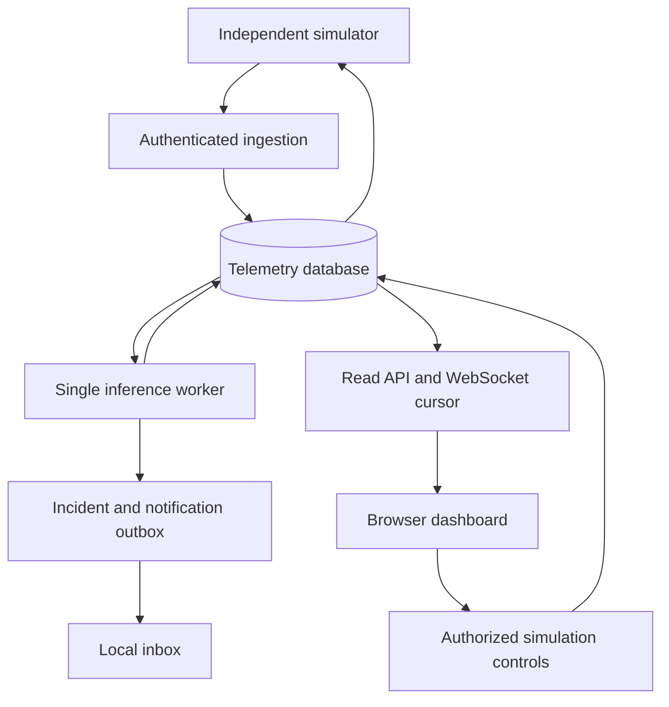

# Architecture and contracts

SQLite with WAL is the default. Docker selects PostgreSQL through `DATABASE_URL`. The code uses SQLAlchemy Core tables and ordinary functions. HTTP is sufficient for three devices and makes durable acceptance easy to inspect. CSV is a reproducible training/export format, not the operational database.

An ingestion transaction stores a unique `(station_id, boot_id, sequence)` identity. Its response says accepted, not diagnosed. Concurrent duplicates use database conflict handling; conflicting values under the same identity return 409. Received times come from the server. Pydantic normalizes event timestamps to UTC. Source provenance is restricted to the supported simulator contract.

One worker reads pending rows in acceptance order. Per station, an event older than or equal to the latest processed event is historical. The worker commits inference, incident transitions and notification jobs together, then marks the reading processed. A crash rolls back that transaction. No Python-only processing queue holds the sole copy of accepted data. The unique telemetry/model result key is an extra integrity constraint. This architecture must run with one API worker; it does not claim distributed exactly-once delivery.

A device token can only ingest its station and retrieve/acknowledge its commands. Viewer keys can inspect all three demo stations. Operator keys can change scenarios, request virtual relay states, acknowledge incidents and append review labels. There is no public model-upload or promotion endpoint. Human keys stay in a local, ignored credentials file with restricted file permissions; device hashes live in the database. Keys are sent in headers or the first WebSocket frame, never in URLs. Public mode grants anonymous read-only access.

The browser subscribes to a committed-result cursor, then refetches durable state and a bounded history window. Slow clients do not run inference or generate readings. At most 20 sockets are admitted. The normal UI polls as a fallback; WebSockets signal committed changes sooner. Disconnects retain historical values with a stale indicator. The last 180 rows are displayed; the database retains the older history.

The API bounds JSON bodies to 128 KB, ingestion batches to 50 readings, history to 500 rows, and requests to 3,000 per source IP per minute. These are local-demo limits, not an Internet-facing denial-of-service defence. A reverse proxy should enforce body and request limits before buffering for hosted traffic. WebSocket origins are explicitly checked. Cookie sessions are not used, so there is no cookie-authenticated write path requiring CSRF tokens.

## Sensor contract

`schemas.py` is authoritative. The contract includes voltage in V, current in A, AC power in W, irradiance in W/m², ambient and surface temperature in °C, humidity in percent, and an independent 0–4095 brightness ADC. Load limits are positive watts. Missing values require a reason. Structurally valid but implausible sensor values are retained as quality failures, never converted to healthy defaults.

Server-side station configuration supplies rated panel power and voltage. The client cannot submit those ratings as extra fields. Ground truth and injected severity never enter the serving payload. Each simulated reading carries an explicit source marker and event clock. There is no serial fallback or fake live weather endpoint.

Commands contain an ID, explicit desired state, expiry, status and confirmed state. A newer pending command supersedes older pending requests. Acknowledgement checks the scoped device, desired value and expiry. A retried acknowledged command is idempotent. The simulator persists its local state before acknowledging it.

## Incidents, quality and uncertainty

The raw class/index follow the single six-label vocabulary. Prediction probabilities retain the selected model's actual values. The result names the probability method; the final experiment selected uncalibrated forest probabilities after calibration lost on validation log loss.

A known label requires the validation-selected confidence threshold and support checks. Otherwise the result is uncertain or unknown. Isolation Forest scores are separate evidence, not physical diagnosis. Eight identical daylight voltage/current pairs flag a stuck sensor. A missing or invalid row produces data_quality. Three agreeing decisions in the last five establish a normal/fault state; the first two readings are warming. An abstention does not close an existing incident. Low irradiance or a confirmed open virtual relay is inactive.

A sustained expected-power deficit means three consecutive residuals above 25%, with a minimum usable expected output. It is displayed as supporting evidence; it does not command a relay. SHAP targets the selected raw class in the underlying forest, not temporal votes or a calibrated transformation.

Schema version one is created by `db.migrate`. A different version is refused. There is no pretend automatic migration to unknown schemas. See the backup-first procedure before a future schema change.

The original React/Next.js dashboard is exported to static files and served from the same origin as the API. The build externalizes Next hydration scripts so script-src remains self-only; Recharts and Framer Motion require inline style attributes. The source and compiled export are both committed.

Each fresh simulator device consults its authenticated control response for the latest stored event time. If the YAML start overlaps stored history, it advances to a later simulated day while preserving the scenario's morning clock. This start is persisted before acquisition; resumed runs keep their recorded start. A device that begins offline uses the YAML start and can produce historical readings until caught up. This is event time, not the current date.
