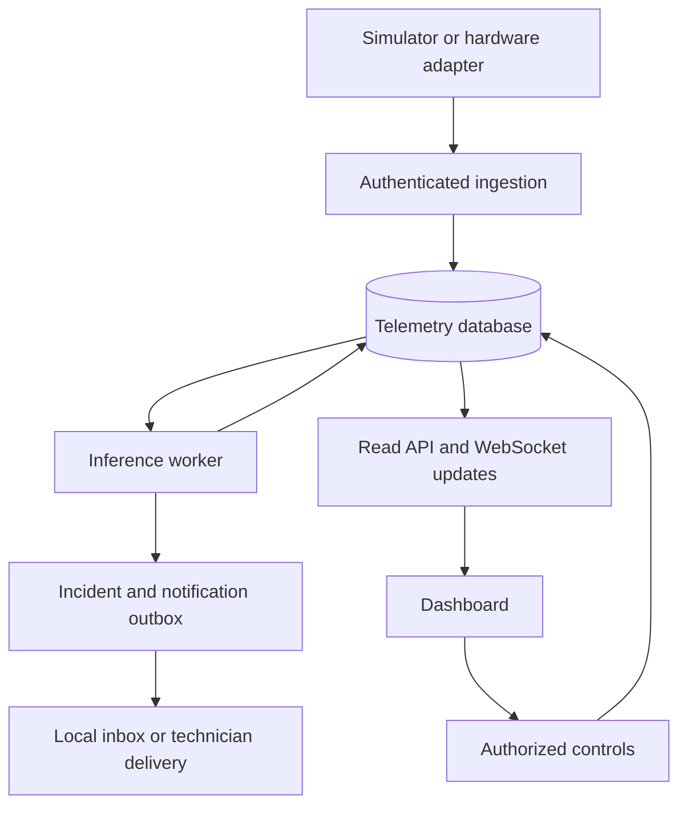

# Architecture

SolarSense separates acquisition from processing and display. A station continues producing data even when no browser is connected. The database is the durable boundary: an ingestion acknowledgement means the reading is stored, while a prediction becomes available after the worker processes it.

## Storage and processing

We use SQLite with WAL for local runs and PostgreSQL through `DATABASE_URL` in Compose. SQLAlchemy Core defines the tables; ordinary functions handle processing. CSV is used for training and export rather than operational storage.

Each reading has a unique `(station_id, boot_id, sequence)` identity. Repeated payloads are deduplicated; different values under the same identity return 409. The server records receive time and normalizes event timestamps to UTC.

A single worker processes pending rows in acceptance order. For each station, an event timestamp older than or equal to the latest processed event is historical. Inference results, incident transitions, notification jobs and processed status are committed in one transaction. A crash rolls back unfinished work, leaving the accepted reading available for recovery. A telemetry/model result key provides an additional uniqueness constraint.

The backend must run with one API worker. The design provides durable local processing and retry handling; it does not implement distributed exactly-once delivery.

## Access and browser updates

Device tokens are scoped to a station. Viewer keys can read the three configured stations. Operator keys can change simulation settings, request commands, acknowledge incidents, configure technician contacts and append review labels. Hardware gateway access uses its own configured key or explicit private-network allowlist.

Operator and viewer keys are stored in an ignored local credentials file with restricted permissions. Device tokens are stored as hashes in the database. Keys travel in headers or the first WebSocket frame, never in URLs. Public mode grants anonymous read-only access. There is no public model-upload or promotion endpoint.

The browser subscribes to a committed-result cursor, then fetches stored state and a bounded history window. Polling provides a fallback. Slow clients do not generate readings or run inference, and disconnected clients retain their last values with a stale indicator. The chart displays the last 180 rows; the database retains older history, and a history request or CSV export is bounded to 500 rows.

The API limits JSON bodies to 128 KB, ingestion batches to 50 readings, concurrent sockets to 20, and requests to 3,000 per source IP per minute. These are local application limits. A hosted reverse proxy should apply its own limits before buffering requests. WebSocket origins are checked explicitly; authentication does not use cookies.

## Measurement contracts

[schemas.py](../src/solarsense/schemas.py) defines the serving contract. Measurements include voltage in V, current in A, AC power in W, irradiance in W/m², ambient and surface temperature in °C, humidity in percent and a separate 0–4095 brightness ADC. Missing values require a reason. Structurally valid but implausible readings are retained as data-quality failures.

Panel ratings come from server-side station configuration. Ground truth, injected severity and future values are excluded from inference inputs. Simulation and hardware readings carry explicit source and clock markers, and the configured station source must match the incoming data.

The gateway adapter maps the original ESP-NOW payload into this contract. Serial adapters retain missing channels instead of estimating them. Hardware DC power is voltage × current; absent AC power and irradiance remain missing. Weather is a separate dashboard service and never fills model inputs. See [HARDWARE.md](HARDWARE.md) for device-specific fields.

## Models and incident state

Simulation inference uses a six-label classifier. Hardware inference uses the separate five-class model and its original feature order. Each result identifies its model and probability method. The simulation experiment selected uncalibrated forest probabilities after sigmoid calibration increased validation log loss.

For the simulation model, a known label must pass validation-selected confidence thresholds and training-support checks. Other outcomes are uncertain or unknown. Isolation Forest supplies separate novelty evidence. Eight identical daylight voltage/current pairs flag a stuck sensor, while missing or invalid inputs produce a data-quality result.

Three agreeing decisions in the last five readings stabilize a normal or fault state; the first two readings are warming. Abstention does not close an existing incident. Low-light conditions and a confirmed open virtual relay suppress active diagnosis in simulation mode.

A simulation power deficit requires three consecutive residuals above 25% with sufficient expected output. It is supporting evidence, not a relay command. TreeSHAP explains the selected raw forest class rather than temporal votes or physical causality. Hardware predictions do not expose synthetic-model SHAP or AC forecasts.

Fault and recovery transitions create notification jobs transactionally. The local inbox and optional HTTP sink support event deduplication. A separate technician worker handles SMS/WhatsApp submission and delivery-status polling. Its retry rules distinguish safe connection failures from ambiguous submissions; see [TECHNICIAN_ALERTS.md](TECHNICIAN_ALERTS.md).

## Commands and source changes

Commands contain an ID, desired state, expiry, status and confirmed state. A newer pending command supersedes older pending requests. Simulator acknowledgements check the device, requested value and expiry, and the simulator persists its local state before acknowledging.

Physical commands are disabled by default. When enabled, the gateway receives the original command strings. Acknowledgement requires command polling followed by a newly accepted matching relay reading before expiry. Relay activation does not imply a universal electrical effect; that depends on wiring. Predictions never switch physical relays automatically.

Switching a station between simulation and hardware clears current display state and cancels pending commands while retaining history. The simulator skips hardware stations. Source boundaries also prevent old readings and commands from being treated as current state.

## Event time and deployment

A fresh simulator checks the latest stored event time through its authenticated control response. If its configured start overlaps existing history, it advances to a later simulated day while keeping the scenario's morning clock. The chosen start is saved with the run. Resuming keeps that timeline; starting offline may produce historical readings until the device catches up. Event time can differ from the current date.

The React/Next.js frontend is statically exported and served by FastAPI locally or Nginx in Compose. The build externalizes hydration scripts to keep script sources restricted to the application origin. Recharts and Framer Motion require inline style attributes. Both frontend source and compiled export are committed.

Database initialization creates schema version one and refuses unknown versions. Future schema changes require an explicit migration and a tested backup/restore path. [OPERATIONS.md](OPERATIONS.md) documents model changes, configuration and recovery.
